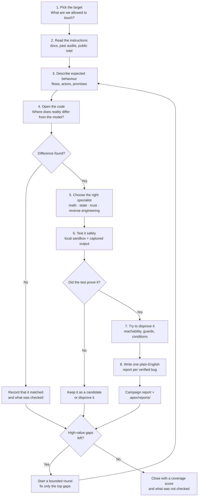

# Apex Core

**A disciplined audit campaign manager for AI agents.**  
**Version 1.1.0**

Apex Core gives an agent a clear process for security work: understand the
target, write down what should happen, compare it with the code, test the
differences, and report only what survives. It runs as an **MCP server** or as a
**normal command line tool**, so it works with Cursor, Claude Desktop, Copilot,
Kilocode, or a custom harness.

It is domain-agnostic: web APIs, EVM, Solana, Move, native binaries, or a mix.

## The idea in one picture



In plain English:

- **A gate is a checklist.** The agent cannot skip a phase just because it is
  excited about a possible bug.
- **A candidate is not a finding.** A scanner hit or an untested idea stays a
  candidate until an executed test proves it.
- **The coverage loop is bounded.** It fixes a few high-value gaps at a time,
  not the whole repository forever.
- **Every target gets its own `.apex/` case file**, so different projects never
  mix evidence.

Each step writes a file in the target’s `.apex/` folder. A step cannot start
until the previous checklist is complete. That is what stops the agent from
jumping straight to “findings.”

## Install

```bash
cd apex-core
python3 -m venv .venv
source .venv/bin/activate
pip install -r requirements.txt
python main.py --list
```

`tree-sitter-language-pack` is optional. Without it, Phase 3 falls back to
pattern extraction and records that honestly.

### One-click setup

```bash
# Cursor, one project, with the shared intel corpus
./scripts/setup.sh --intel --client cursor --target /absolute/path/to/target

# Claude Desktop, global one-time server
./scripts/setup.sh --intel --client claude
```

The script creates the venv, installs dependencies, syncs the intel corpus,
writes the MCP config, and sets the policy. `--force` replaces an existing
`apex-core` entry.


## Connect it to Cursor

**One-time global setup (recommended):** configure the server once, then pass
the target workspace in each tool call. One server can serve every project.

```json
{
  "mcpServers": {
    "apex-core": {
      "command": "/ABS/PATH/apex-core/bin/apex",
      "args": ["--mcp"],
      "env": {
        "APEX_INTEL_CORPUS": "/home/you/.apex/intel/bugbounty-intel"
      }
    }
  }
}
```

At the start of a campaign the agent calls `phase6_campaign` action `start`
once with the target and policy, then calls `phase0_ground` action `scope`
without repeating the target:

```json
{"workspace": "/ABS/PATH/TARGET", "action": "start", "payload": {"policy": "standard", "repos": ["."]}}
```

Each target gets its own `.apex/` case file. `phase6_campaign` action `status`
reports the next phase and whether strict mode is ready. If the client
restarts, bind again. If you prefer a fixed default instead, add `--workspace`
to the server args.

## Connect it to Claude Desktop

Edit `claude_desktop_config.json`:

- macOS: `~/Library/Application Support/Claude/claude_desktop_config.json`
- Windows: `%APPDATA%\Claude\claude_desktop_config.json`
- Linux: `~/.config/Claude/claude_desktop_config.json`

```json
{
  "mcpServers": {
    "apex-core": {
      "command": "/ABS/PATH/apex-core/bin/apex",
      "args": ["--mcp"],
      "env": {
        "APEX_INTEL_CORPUS": "/home/you/.apex/intel/bugbounty-intel"
      }
    }
  }
}
```

This is also one-time. The agent supplies the target workspace per call.
`bin/apex` already prefers the project virtualenv, so no Python path is needed.

## Use it from Copilot, Kilocode, or any CLI agent
No MCP needed. Give the agent `SYSTEM_PROMPT.md` and let it call:

```bash
python /ABS/PATH/apex-core/main.py 0 parse_scope --workspace /ABS/PATH/TARGET --repos .
python /ABS/PATH/apex-core/main.py --status --workspace /ABS/PATH/TARGET
```

Read the JSON response; do not scrape console text.


## Finding reports

At the end of a campaign, `phase6_report` action `generate` writes:

- `.apex/06_final_report.md` — the campaign report
- `.apex/reports/index.md` — one line per finding
- `.apex/reports/verified/H-xxxx.md` — standard report per verified finding
- `.apex/reports/candidates/H-xxxx.md` — clearly marked unverified candidates

Each finding report uses: Title, Severity, Summary, Description (intended vs
actual), Impact, Proof of Code, and Recommendation(s). Use
`phase6_draft_finding_report` first for non-technical wording.

## Team onboarding

New to the tool? Read [How team members use Apex Core](docs/ONBOARDING.md) for
the exact clone → install → MCP/CLI setup, target workspace rules, and the
pipeline feedback mechanism.

## Learn more

- [Plain-English overview](docs/OVERVIEW.md) — start here if you are not technical
- [The seven phases](docs/PHASES.md) — what each stage does
- [State and gates](docs/STATE_AND_GATES.md) — the case file and checklists
- [The coverage loop](docs/COVERAGE_LOOP.md) — how second passes work
- [Tool reference](docs/TOOLS.md) — every tool in one table
- [Extending](docs/EXTENDING.md) — add an adapter or a tool
- [Publishing](docs/PUBLISHING.md) — push the repo and keep the intel corpus linked
- [Technical architecture](docs/ARCHITECTURE.md) — the original deep dive

## Safety

- Static tools are read-only and time-limited.
- `invariant_tester` only executes when `execute=true` and a command is supplied.
- Sandbox templates disable networking and drop capabilities by default.
- The report never upgrades a candidate to a finding without an executed
  experiment and adversarial checks.
- The user owns submission. The agent never submits, emails, or discloses.
