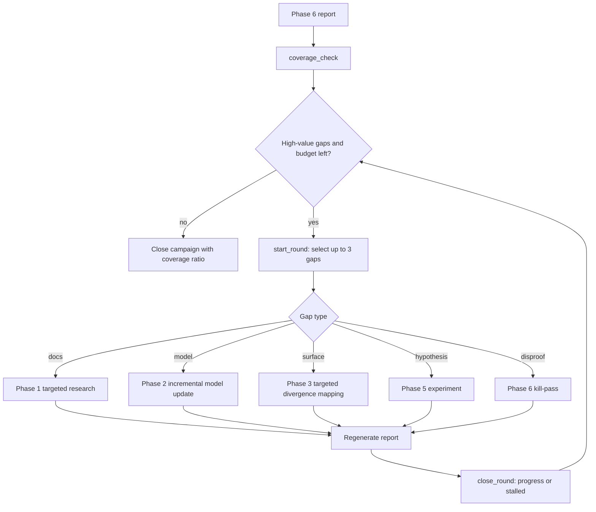

# The coverage loop

## Why a second pass exists

The first report answers “what did we find?” The coverage loop answers “what did
we not look at?” Those are different questions, and audits fail on the second
one far more often.

The loop is deliberately **not** “keep scanning until every file is read.” That
would burn the campaign on vendored code, generated files, and low-value
utilities. Instead it is:

1. Measure coverage.
2. Rank the gaps by impact.
3. Fix only the highest-value gaps.
4. Record whether the round produced new evidence.
5. Stop when the budget is gone, the gaps are low-value, or a round stalls.



## What counts as coverage

Coverage is a **ratio of dispositions**, not a count of files read.

- every in-scope flow: audited, queued, or excluded with a reason
- every extracted surface entry: mapped or excluded with a reason
- every registered sink: at least one hypothesis or chain, or a “no path” note
- every hypothesis: tested, disproved, or parked with a reason
- every intel technique: fired or `KILLED-BY-EXAMINATION`

The report prints `covered N/M (P%)`. If the extractor only understands some
languages, the honest label is `lower-bound`, not `complete`.

**Fail closed.** An `unmapped_critical_flow` divergence is a gap, not coverage.
If any critical flow has no real AST mapping, `coverage_check` sets ratio to 0
and confidence to `fail-closed`. Do not treat “8/14 flows have a DIV-*” as done
when the DIVs are unmapped stubs.

## Gap types and where they go

| Gap | Next phase | Why |
|---|---|---|
| Documentation or API schema missing | 1 | Intent is still unknown |
| Flow or actor not modeled | 2 | Phase 3 has nothing to compare against |
| State vocabulary or sink missing | 2 | Later facts cannot be bound |
| Surface not mapped to a divergence | 3 | The code path has not been compared to the model |
| Hypothesis has no experiment | 5 | It is still a candidate |
| Hypothesis has no kill-pass | 6 | It has not been attacked |
| Sink has no hypothesis or chain | 4 | No one has tried to reach the valuable outcome |
| Critical flow unmapped | 3 | Fail-closed; ratio is 0 until the entry maps |
| Never-generated self-check not run, or mutator × var pair untouched | 4 | `never_generated_check` must name every pair |

Sending every gap to Phase 3 is the common mistake. It produces a pile of
“undocumented entrypoint” notes with no model to interpret them.

## The round contract

Each round gets `.apex/rounds/round-N.json`:

```json
{
  "round": 2,
  "status": "closed",
  "gaps_selected": ["GAP-HYP-H-0004"],
  "outcome": "progress",
  "tools_run": ["invariant_tester"],
  "new_divergences": 0,
  "new_hypotheses": 0,
  "new_experiments": 1,
  "closed_gaps": 1,
  "remaining_gaps": [],
  "stop_reason": null
}
```

## Stop rules

- **Max gaps per round:** 2–3 by default.
- **Max rounds:** 2–3 before a user override.
- **No-progress rule:** if a round adds no divergence, hypothesis, experiment,
  or disposition, mark it `stalled` and stop.
- **Budget rule:** if the agent’s context/quota is nearly gone, call
  `close_session` and write the death-note.
- **Value rule:** a gap touching a registered sink outranks a gap in a utility
  file every time.

## What “done” means

A campaign is done when:

> every in-scope surface has a disposition, every sink has a finding or a
> no-path note, every promoted finding has a disproof, and the remaining gaps
> are explicitly parked with a reason.

Not when every file has been opened.
